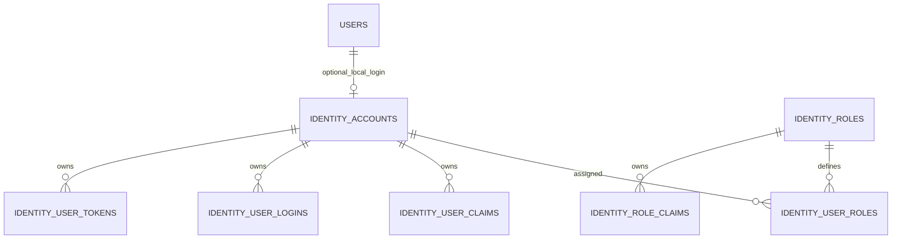
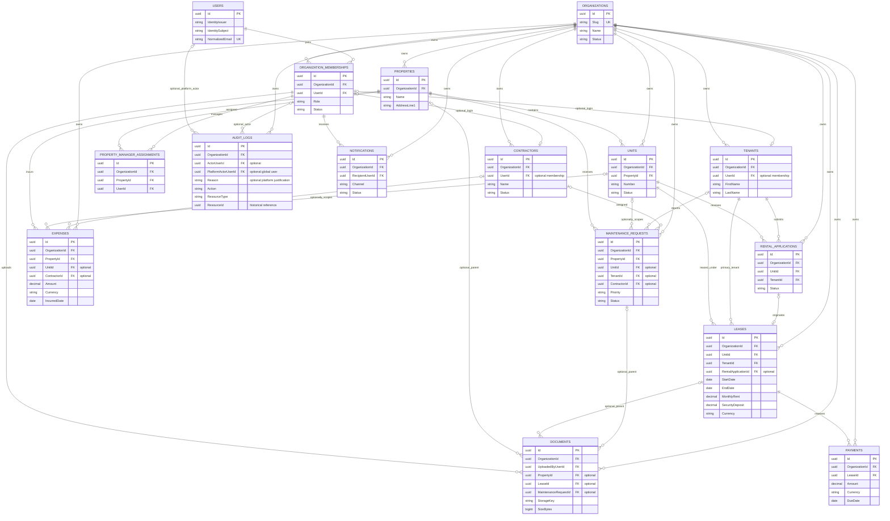

# Initial Demeure database

## Scope and accepted decisions

EF Core 10 Code First is the schema source. PostgreSQL is the production target;
SQLite is supported for local development and relational integration tests.
There are **16 domain/application tables** (the original 15 plus property-manager
assignments) and the **seven standard Identity
tables** added by `AddIdentityAuthentication`. EF also owns its migration-history
table and SQLite migration-lock bookkeeping.

- One primary tenant per lease, as selected for this phase; no lease-tenant join table.
- Domain Users remain global identities identified by issuer + subject. Local
  registration uses issuer `demeure-local`; password hashes/security stamps live
  only in Identity accounts with the same GUID. Existing external identities are
  not automatically converted into password accounts.
- Organization membership is the explicit link between users and organizations.
- Every tenant-owned record has a required OrganizationId.
- Relationships use scalar IDs and EF configurations, not cross-module navigation
  graphs. Modules retain logical ownership; persistence is composed centrally.
- Authentication endpoints and account verification/reset email delivery are
  implemented, along with protected read-only resource endpoints and explicit
  platform-access auditing. No rental CRUD, automatic general audit collection, general notification
  delivery, payments provider, file-storage implementation or seed data is added.
- No subscription, reporting, status lookup, address, payment-allocation or
  speculative join tables are introduced.

## Types and common columns

| Concern | PostgreSQL | SQLite / application |
| --- | --- | --- |
| Primary keys | `uuid`, generated by application | Guid stored as TEXT |
| Money | `numeric(18,2)` | decimal in C#; exact integer minor units in SQLite |
| Instants | `timestamp with time zone` | DateTimeOffset; SQLite stores UTC ticks as INTEGER |
| Calendar dates | `date` | DateOnly; SQLite stores ISO dates |
| Statuses | bounded varchar with allowed-value CHECK | C# enums, string storage and CHECK constraints |
| Text | bounded varchar, required/optional explicitly configured | TEXT; SaveChanges enforces required nonblank values and configured maximum length |

Every domain table has `Id`, `CreatedAt`, and `UpdatedAt`. Tenant-owned tables
also have `OrganizationId`; Organization itself owns its Id, and Users are global.
AuditLog uses the same timestamps, but updates/deletes through SaveChanges are rejected.

SaveChanges generates UTC creation/update timestamps, preserves CreatedAt on
updates, and normalizes optional DateTimeOffset instants to UTC. Calendar dates
such as lease start/end and payment due dates are not timezone-bearing instants.
Money is never converted to floating point: values with more than two fractional
digits or outside decimal(18,2) are rejected rather than rounded.

Money records carry an uppercase three-letter currency code. Currency consistency
between leases/payments and actual ISO currency validation remain application
rules for their future use cases; no FX conversion or accounting engine is implied.

## Tables, fields and relationships

All fields below are required unless marked **optional**. Common columns are omitted.

| Table | Fields | Relationships / constraints |
| --- | --- | --- |
| organizations | Name (200), Slug (100), Status | Unique normalized lowercase Slug |
| users | IdentityIssuer (300), IdentitySubject (200), Email (254), NormalizedEmail (254), DisplayName (200), Status | Unique issuer+subject and case-normalized email; no organization-specific permissions here |
| organization_memberships | UserId, Role, Status | Organization + User; unique (OrganizationId, UserId); retain removed memberships for historical references |
| properties | Name (200), AddressLine1 (300), City (100), PostalCode (20), CountryCode (2), Status; optional AddressLine2 (300), Region (100) | Organization-owned; uppercase two-character country code |
| property_manager_assignments | PropertyId, UserId | Composite organization/property and organization/member FKs; unique organization/user/property assignment |
| units | PropertyId, Number (50), Bedrooms, Bathrooms, Status | Organization+Property FK; unique number within property; room counts nonnegative; whole-number bathroom counts for initial scope |
| tenants | FirstName (100), LastName (100), Status; optional UserId, Email (254), Phone (30) | Optional link to membership in the same organization; one tenant profile per linked user per organization |
| rental_applications | UnitId, TenantId, Status; optional SubmittedAt, DecidedAt | Organization-scoped Unit and Tenant FKs; decision time cannot precede submission |
| leases | UnitId, TenantId, StartDate, EndDate, MonthlyRent, SecurityDeposit, Currency, Status; optional RentalApplicationId | Exactly one primary tenant; optional application must match organization, unit and tenant; one lease per application; end > start, rent > 0, deposit >= 0 |
| payments | LeaseId, Amount, Currency, DueDate, Status; optional PaidAt, Reference (200) | Organization-scoped Lease FK; amount > 0; tenant and unit derive from the lease |
| expenses | PropertyId, Description (1000), Amount, Currency, IncurredDate, Status; optional UnitId, ContractorId | Organization-scoped FKs; optional Unit must belong to the specified Property; amount > 0 |
| maintenance_requests | PropertyId, Title (200), Description (4000), Priority, Status; optional UnitId, TenantId, ContractorId, CompletedAt | Organization-scoped FKs; optional Unit belongs to the specified Property |
| contractors | Name (200), Status; optional UserId, Email (254), Phone (30), Trade (100) | Optional login references same-organization membership; unique organization/user link |
| documents | UploadedByUserId, FileName (255), ContentType (127), StorageKey (500), SizeBytes, Status; optional PropertyId, LeaseId, MaintenanceRequestId | Uploader is an organization member; unique organization+storage key; nonnegative size; zero or one parent; metadata only, never file bytes |
| notifications | RecipientUserId, Title (200), Body (4000), Channel, Status; optional SentAt, ReadAt | Recipient must be a member of this organization; membership status authorization remains a use-case rule |
| audit_logs | Action (100), ResourceType (100); optional ActorUserId, PlatformActorUserId, Reason (500), ResourceId, TraceId (64) | Member actor references membership; platform actor references global User; at most one actor kind; ResourceId is historical evidence, intentionally not a polymorphic FK; append-only through tracked persistence |

All FKs use **RESTRICT** deletion. Archive/status transitions are preferred to
deleting referenced history. There is no blanket cascade or implicit soft-delete
filter; archived data remains queryable by an authorized organization.

Tenants can exist without a login. Linking a tenant to a User requires membership.
Notifications/documents/audit actors also use membership FKs, so an arbitrary
global UserId cannot silently associate with another organization.

Document links are deliberately limited to property, lease, or maintenance records
in this initial schema. Extending document attachment types requires a requested
use case and explicit foreign keys; do not add unchecked `(type, id)` relations.

## Statuses

| Record | Allowed statuses |
| --- | --- |
| Organization | Active, Suspended, Archived |
| User | Active, Disabled |
| Membership | Active, Suspended, Removed |
| Property | Active, Inactive, Archived |
| Unit | Available, Occupied, Unavailable, Archived |
| Tenant | Active, Inactive, Archived |
| Rental application | Draft, Submitted, UnderReview, Approved, Rejected, Withdrawn |
| Lease | Draft, Active, Ended, Terminated, Cancelled |
| Payment | Pending, Completed, Failed, Cancelled, Refunded |
| Expense | Draft, Approved, Paid, Cancelled |
| Maintenance request | Open, Assigned, InProgress, Completed, Cancelled |
| Contractor | Active, Inactive, Archived |
| Document | Available, Archived |
| Notification | Pending, Sent, Failed |

Membership roles: Owner, Administrator, Manager, Member.
Maintenance priority: Low, Normal, High, Emergency.
Notification channels: InApp, Email.
AuditLog has no workflow status.

Enums have database CHECK constraints. The eight initial behavior-rich entities
now enforce the [domain lifecycle rules](domain.md), including draft-only lease
terms, terminal states and payment completion/refund evidence. Active lease overlap,
occupancy synchronization and external settlement remain future application rules;
the schema does not pretend those coordinated workflows have been implemented.

## Organization isolation

1. Tenant-owned entities have alternate keys `(OrganizationId, Id)`.
2. Every FK between tenant-owned records includes OrganizationId. A unit in one
   organization cannot refer to a property in another, even through raw SQL.
3. Expense/maintenance links additionally use `(OrganizationId, PropertyId, UnitId)`.
4. Lease-to-application links additionally include UnitId and TenantId.
5. Global query filters scope tenant-owned tables and Organization itself to
   `IOrganizationContext.OrganizationId`; a missing/empty context throws, not
   silently returning all data or choosing a default organization.
6. SaveChanges checks organization ownership for tracked inserts, updates and deletes.
7. Users remain global and require explicit identity/platform authorization in
   future application services; the DbContext is not an authorization endpoint.

Persistence-only registration deliberately supplies an unavailable context.
The API's Identity registration replaces it with a request-scoped context populated
only after authenticated active-membership checks. Missing/ambiguous organization
selection fails closed; a client-supplied ID does not grant access.
Migrations and model inspection do not need an organization context.

Filters/write guards remain defense in depth, separate from the new PostgreSQL RLS.
Raw SQL, ExecuteUpdate/ExecuteDelete, IgnoreQueryFilters and privileged database
access can bypass tracked guards; they must not be used as tenant-data shortcuts.
Audit append-only behavior is enforced by SaveChanges, not a database trigger.
`AddResourceAuthorization` enables and forces PostgreSQL organization RLS on
business tables; transaction-local context additionally requires live membership
or explicit stored platform role. Bootstrap Organization/Membership/Identity
tables remain outside RLS. See [authorization](authorization.md) for exact
exclusions, transaction usage, runtime-role privileges and verification.
Business endpoints must add use-case permission checks and scoped contracts;
authentication already has cross-organization tests. Use a least-privilege database role in production.

### Identity storage

`identity_accounts` references `users.Id` with a restrictive FK (one local account
per domain user). `identity_roles`, `identity_user_roles`, `identity_user_claims`,
`identity_role_claims`, `identity_user_logins` and `identity_user_tokens` are standard
Identity-owned tables. Identity relationships cascade internally, not into domain
records. No JWT refresh tokens or application session table are introduced.
Organization permissions stay in `organization_memberships`, not global Identity roles.
The membership role CHECK now also permits Tenant and Contractor.



Apply the additive migration for the selected provider using the commands below.
SQLite rebuilds its membership table to update the role CHECK; take a backup and
run migrations without concurrent writers. EF warns about nontransactional
foreign-key PRAGMAs during this provider-specific rebuild.

## Index strategy

- Unique external identity and normalized email for Users.
- Unique organization slug and organization/user membership.
- Unique unit number per organization/property.
- Organization-prefixed status indexes for properties, units, memberships and contractors.
- Organization/status/time indexes for rental applications and notification delivery.
- Organization/unit/status for leases; organization/status/due date for payments.
- Organization/property/incurred date for expenses.
- Organization/status/priority for maintenance queues.
- Organization/recipient/read timestamp/created timestamp for notification inboxes.
- Organization/created time and organization/resource type/resource ID for audit queries.
- Unique organization/storage key for documents.
- EF also indexes FK columns where an existing key/index does not already cover them.

Composite alternate keys are intentional: they make cross-organization and
same-property/application constraints enforceable at the database boundary.
Avoid adding indexes without an actual lookup/constraint requirement.

## ER diagram

The diagram summarizes FK cardinality. Every tenant-owned table also belongs to
Organization. Composite FK details are described above; timestamps and most
ordinary fields are omitted for readability.



## Local SQLite setup

Run from the repository root in PowerShell. No SQLite executable or server is
required: EF's SQLite provider includes the native engine.

```powershell
dotnet tool restore
dotnet restore Demeure.slnx

# Use one explicit path so the API and EF CLI open the same database.
$databasePath = Join-Path (Get-Location) "backend\Demeure.Api\demeure.db"
$env:DEMEURE_SQLITE_CONNECTION = "Data Source=$databasePath;Foreign Keys=True"
dotnet ef database update --project backend\Demeure.Infrastructure --context SqliteDemeureDbContext

$env:ConnectionStrings__Demeure = $env:DEMEURE_SQLITE_CONNECTION
dotnet run --project backend\Demeure.Api
```

Development selects `Database:Provider=Sqlite`. Override it explicitly if using
`--no-launch-profile` with a different environment. Relative Data Source paths are
resolved against the process working directory, so explicit paths are recommended.
The SQLite files are ignored by Git. Migrations do **not** seed application data.

Migrations are explicit administrative steps, never automatically applied by API
startup. Health checks retain their existing operational contract; no database
readiness check is registered yet.

### SQLite differences

- Money is stored as cents (INTEGER), not NUMERIC affinity or REAL, to avoid precision
  loss. Raw SQLite inspection displays `123456` for C# `1234.56m`.
- UTC instants are integer .NET UTC ticks (100ns units since year 1), not Unix timestamps.
- SQLite cannot fully emulate PostgreSQL text limits/type rigidity, concurrency,
  SQL operators, query plans or migration behavior.
- Decimal/date query support differs by provider; validate concrete reporting and
  aggregate queries on PostgreSQL when implemented. Do not infer that a SQLite
  test verifies PostgreSQL locking, timezone/session semantics or live migration execution.
- Keep foreign-key enforcement enabled (`Foreign Keys=True`).

## PostgreSQL configuration and migrations

Production defaults to PostgreSQL and requires a connection string. There is no
embedded credential or automatic fallback to SQLite if the connection is missing.

Configure these via your local environment, user secrets, or deployment secret
manager; never paste real credentials into documentation or source control:

```text
Database__Provider=PostgreSQL
ConnectionStrings__Demeure=<your PostgreSQL connection string>
DEMEURE_POSTGRES_CONNECTION=<same connection for EF design-time commands>
```

The PostgreSQL design-time factory can generate a migration/SQL without a server
using a non-secret local placeholder. Applying it requires the real configured
connection and database privileges:

```powershell
dotnet ef migrations script --idempotent --project backend\Demeure.Infrastructure --context DemeureDbContext
dotnet ef database update --project backend\Demeure.Infrastructure --context DemeureDbContext
```

Review SQL before deployment. Do not run the PostgreSQL migration against SQLite,
or use the SQLite migration history as PostgreSQL history. Switching providers is
not a data migration; do not copy the SQLite file or assume automatic data transfer.

Maintain both migration sets when the shared model changes:

```powershell
dotnet ef migrations add DescribeChange --project backend\Demeure.Infrastructure --context DemeureDbContext --output-dir Persistence\Migrations\PostgreSql
dotnet ef migrations add DescribeChange --project backend\Demeure.Infrastructure --context SqliteDemeureDbContext --output-dir Persistence\Migrations\Sqlite

dotnet ef migrations has-pending-model-changes --project backend\Demeure.Infrastructure --context DemeureDbContext
dotnet ef migrations has-pending-model-changes --project backend\Demeure.Infrastructure --context SqliteDemeureDbContext
```

The SQLite DbContext derives from the PostgreSQL/shared context only to keep
provider-specific migration discovery and snapshots separate. It shares the
entity model, isolation guards and constraints; provider-specific storage
conversions are configured centrally in Infrastructure.

## Verification and outstanding work

SQLite integration tests apply actual migrations to isolated in-memory databases,
seed **test-only** records, test relationships/isolation/constraints, round-trip
money/dates/UTC instants, and roll back/reapply the initial migration.
PostgreSQL model tests verify native types, composite FKs, snapshot consistency,
and idempotent SQL generation without connecting to a server.

Live PostgreSQL execution remains pending because SQLite was selected for this
phase. Before production, run the migration and the relational integration
scenarios against PostgreSQL. Authentication/organization context, domain workflow
rules and isolation guards are implemented; use-case authorization and appropriate
audit emission must accompany new business endpoints.
